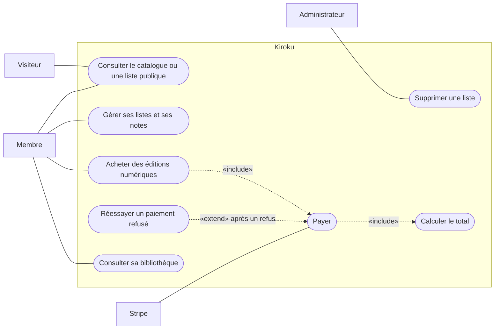
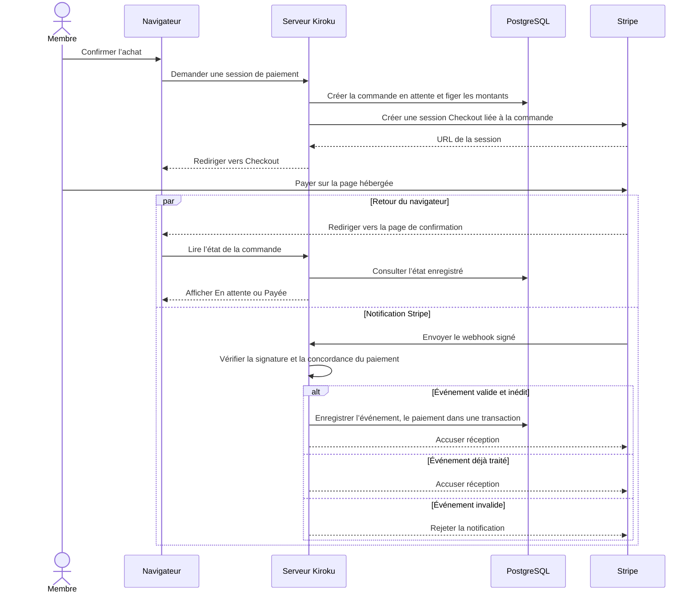

# Cahier des charges — Kiroku

- **Applications Web transactionnelles (420-951-MA), groupe 25604**
- **Laboratoire 1 · Version 0.1 · Brouillon de travail**
- **Option A - Continuité du projet de Services Web**
- **Équipe - Jean-Simon Cyr et Émile Valade**

## 1. Contexte, problème, public cible et concurrents

### 1.1 Problème et public cible

Les amateurs d’anime et de manga qui découvrent des œuvres à plusieurs endroits peuvent perdre du temps à retrouver un titre recommandé ou à reconstituer une liste à partager. Kiroku rassemble la consultation du catalogue, le classement des œuvres et leur évaluation dans une seule application Web.

- **Public principal** - Les amateurs qui veulent organiser leur sélection et retrouver leurs notes.
- **Public secondaire** - Les personnes qui préparent des recommandations thématiques et souhaitent les partager.
- **Coût du problème** - [À compléter avec une observation de l’équipe, par exemple le temps nécessaire pour retrouver une recommandation dispersée entre des messages et des notes.]

### Analyse de la concurrence

| Solution | Offre à comparer | Prix vérifié et date | Limite à évaluer pour notre public |
|---|---|---|---|
| AniList | Catalogue et suivi d’anime et de manga | [À compléter avec une source officielle] | [À vérifier] Possibilité d’acheter une édition numérique depuis la fiche d’une œuvre. |
| MyAnimeList | Catalogue, listes de suivi et évaluations | [À compléter avec une source officielle] | [À vérifier] Facilité de partager une sélection avec une personne qui découvre le service. |

**Positionnement** — Kiroku réunit la découverte, les listes et l’achat d’éditions numériques de mangas et d’animes.

## 2. Vision, SWOT, persona et 7 P

### Cercle d’or

| Cercle d’or | Kiroku |
|---|---|
| Pourquoi (Why) | Aider les amateurs à retrouver les œuvres qui les intéressent et à partager leurs découvertes. |
| Comment (How) | Combiner un catalogue alimenté par AniList avec des listes publiques ou privées et des notes personnelles. |
| Quoi (What) | Une application Web de découverte et de classement avec un parcours d’achat simulé d’éditions numériques. |

La version existante permet de consulter des œuvres, de gérer des listes et de noter des titres. La version transactionnelle ajoute un panier et une bibliothèque des éditions achetées.

### SWOT

| | Facteurs favorables | Facteurs défavorables |
|---|---|---|
| Interne | Catalogue déjà intégré · Gestion des listes déjà présente · Comptes et rôles existants | Équipe de deux · Parcours de paiement à construire · Éditions de démonstration à choisir |
| Externe | Partage de recommandations entre amis · Intérêt potentiel pour une bibliothèque numérique centralisée · Communautés d’amateurs pour recueillir des retours | Concurrents établis · Disponibilité de l’API AniList · Disponibilité des éditions selon les territoires |

### Persona fictif

**Camille, 23 ans, amatrice d’anime et de manga.** Elle découvre des titres dans des discussions et conserve ses recommandations sur son téléphone. Elle veut retrouver rapidement une œuvre et transmettre une sélection à ses amis. Les titres éparpillés et les doublons la frustrent. Elle utilise le catalogue et les listes gratuitement. Elle pourrait payer quelques dollars pour une édition numérique d’une œuvre qui l’intéresse **[hypothèse à valider]**.

### Les 7 P

| P | Proposition |
|---|---|
| Produit | Catalogue, listes, évaluations et achat simulé d’éditions numériques. |
| Prix | Fonctionnalités de base gratuites et achat unique par édition numérique. |
| Place | Application Web accessible sur ordinateur et téléphone. |
| Promotion | [À valider] Présenter une liste publique d’exemple lors de la démonstration et auprès de personnes du public cible. |
| Personnes | Les deux membres de l’équipe assurent le développement. [À compléter] Responsable du soutien. |
| Processus | Choisir une édition numérique, l’ajouter au panier et la retrouver dans sa bibliothèque après paiement. |
| Preuve physique | Aperçu d’une liste publique, récapitulatif avant paiement et confirmation de commande. |

## 3. Modèle de paiement

Le membre paie une fois par édition numérique. Il peut acheter un manga, un anime ou les deux selon les éditions offertes. Ce modèle convient à un achat ponctuel. Pour la démonstration, Stripe fonctionne en mode test et la livraison est simulée par l’ajout des éditions achetées à la bibliothèque du compte. Le prix indicatif de 4,99 $ CA par édition est **[À valider]**.

| Offre | Fonctionnalités | Avant taxes | TPS | TVQ | Total |
|---|---|---:|---:|---:|---:|
| Gratuit | Consulter le catalogue et les listes publiques. Avec un compte, gérer ses listes et noter des œuvres. | 0,00 $ | 0,00 $ | 0,00 $ | 0,00 $ |
| Manga numérique | Ajouter une édition de manga à sa bibliothèque. | 4,99 $ | 0,25 $ | 0,50 $ | 5,74 $ |
| Anime numérique | Ajouter une édition d’anime à sa bibliothèque. | 4,99 $ | 0,25 $ | 0,50 $ | 5,74 $ |

**Exemple du laboratoire en cents** — Pour 499 cents, la TPS à 5 % donne 24,95 cents, arrondis à 25, et la TVQ à 9,975 % donne 49,77525 cents, arrondis à 50. Le total est de 574 cents. Chaque taxe est arrondie séparément (RM-04).

| Parcours | Ce que voit la personne | Réaction du système |
|---|---|---|
| Achat | Récapitulatif, paiement Stripe, puis confirmation ou attente. | Crée une commande en attente. Les éditions apparaissent dans la bibliothèque après confirmation de Stripe (RM-04 à RM-06). |
| Paiement refusé | Message d’échec sur la page de paiement et possibilité de réessayer. | Garde la commande en attente tant que la session permet un nouvel essai. Les éditions de cette commande ne sont pas ajoutées à la bibliothèque (RM-05). |
| Annulation | Retour au panier après avoir quitté Stripe. | Garde la commande en attente jusqu’à l’expiration confirmée de la session (RM-07). |
| Remboursement | Demande au soutien, puis confirmation après traitement. | Après remboursement intégral confirmé, les éditions de la commande sont retirées de la bibliothèque et la commande est conservée (RM-08). |
| Renouvellement | Sans objet pour un achat unique. | Aucun prélèvement récurrent. |

**[À compléter]** Fixer le délai et les conditions de remboursement. Confirmer les événements Stripe à traiter pour le paiement réussi, l’expiration de session et le remboursement.

## 4. User stories, critères d’acceptation et cas d’utilisation

### Backlog et critères d’acceptation

| ID | MoSCoW | Story |
|---|---|---|
| US-01 | Must | En tant que visiteur, je veux consulter le catalogue afin de découvrir des œuvres. |
| US-02 | Must | En tant que visiteur, je veux créer un compte afin de gérer mes listes personnelles. |
| US-03 | Must | En tant que membre, je veux créer et modifier une liste afin de classer mes recommandations. |
| US-04 | Must | En tant que membre, je veux choisir la visibilité de ma liste afin de décider si elle peut être partagée. |
| US-05 | Must | En tant que membre, je veux ajouter et retirer des œuvres afin de garder mes listes à jour. |
| US-06 | Should | En tant que membre, je veux noter une œuvre afin de conserver mon appréciation. |
| US-07 | Must | En tant que membre, je veux ajouter des éditions à mon panier et voir le total avec taxes afin de connaître le coût avant de payer. |
| US-08 | Must | En tant que membre, je veux payer sur Stripe afin d’acheter les éditions numériques de mon panier. |
| US-09 | Must | En tant que membre, je veux voir l’état de ma commande afin de savoir si mon achat est confirmé. |
| US-10 | Must | En tant que membre, je veux consulter ma bibliothèque afin de retrouver les éditions numériques que j’ai achetées. |
| US-11 | Should | En tant qu’administrateur, je veux supprimer une liste signalée afin de retirer un contenu inapproprié. |
| US-12 | Must | En tant que membre, je veux pouvoir demander un remboursement afin de faire traiter une demande liée à mon achat. |

| ID | Story | Étant donné… | Quand… | Alors… |
|---|---|---|---|---|
| CA-01 | US-04 | une liste privée | un autre membre ouvre son URL | l’accès est refusé. |
| CA-02 | US-07 | le tarif proposé de 499 cents | le membre ouvre le récapitulatif | il voit 499 cents, 25 cents de TPS, 50 cents de TVQ et 574 cents au total. |
| CA-03 | US-08 | une commande en attente | Stripe confirme le paiement avec un événement signé et un montant concordant | la commande passe à l’état payé et les éditions achetées apparaissent dans la bibliothèque. |
| CA-04 | US-08 | une commande en attente | la carte est refusée | un message d’échec apparaît et aucune édition de cette commande n’est ajoutée à la bibliothèque. |
| CA-05 | US-09 | une commande en attente | le membre revient de Stripe avant le webhook | la page affiche une confirmation en attente. |
| CA-06 | US-09 | un événement de confirmation déjà traité | Stripe renvoie le même événement | la commande reste payée et aucun droit supplémentaire n’est créé. |
| CA-07 | US-10 | deux comptes ayant acheté des éditions différentes | un membre consulte sa bibliothèque | seules les éditions achetées par son compte apparaissent. |
| CA-08 | US-12 | une commande payée | Stripe confirme le remboursement intégral | la commande passe à l’état remboursé et les éditions de la commande sont retirées de la bibliothèque. |

### Acteurs et cas d’utilisation

| Acteur | Rôle |
|---|---|
| Visiteur | Consulte le catalogue et les listes publiques. |
| Membre | Gère ses listes et ses notes. Peut acheter des éditions numériques et consulter sa bibliothèque. |
| Administrateur | Peut supprimer une liste d’un autre compte. |
| Clerk | Assure l’authentification. |
| AniList | Fournit les données du catalogue. |
| Stripe | Héberge la page de paiement et transmet les événements. |

#### Diagramme de cas d’utilisation

#### UC-01 — Payer

**Acteur principal** - Membre. **Acteur secondaire** - Stripe.

**Préconditions** — Le membre est connecté et son panier contient au moins une édition numérique disponible.

1. Le membre consulte le récapitulatif de son panier, avec le sous-total, les deux taxes et le total.
2. Il confirme l’achat. Le serveur enregistre la commande en attente et demande une session Stripe Checkout.
3. Le membre paie sur la page hébergée par Stripe.
4. À la réception d’un événement Stripe signé, le serveur vérifie la commande et le montant, puis enregistre le paiement et les éditions achetées apparaissent dans la bibliothèque.
5. La page de confirmation affiche l’état enregistré par le serveur.

**Variantes** - Carte refusée, retour au panier, confirmation encore en attente et notification reçue en double. Voir RM-05 à RM-07.

**Postcondition de succès** - La commande est payée et le membre retrouve les éditions achetées dans sa bibliothèque.

### Règles métier

| ID | Règle |
|---|---|
| RM-01 | Le propriétaire peut modifier sa liste. Lui et l’administrateur peuvent la supprimer. Une liste privée est accessible à son propriétaire et aux administrateurs. |
| RM-02 | Une œuvre figure au plus une fois dans une même liste. |
| RM-03 | Un membre possède au plus une évaluation par œuvre. La note est comprise entre 0 et 10. |
| RM-04 | Les montants sont des entiers en cents. Les taxes sont calculées et arrondies séparément. Le nom et le prix du produit sont figés à la commande. |
| RM-05 | Une commande devient payée après validation côté serveur du webhook Stripe signé et concordance du paiement avec la commande, le montant et la devise. |
| RM-06 | Chaque événement Stripe est traité au plus une fois. Chaque bibliothèque affiche les éditions issues des commandes payées du compte. |
| RM-07 | La commande reste en attente lors d’un retour au panier. Une session expirée confirmée clôt la commande en attente. |
| RM-08 | Un remboursement intégral confirmé retire de la bibliothèque les éditions acquises par cette commande. Les commandes et remboursements sont conservés pendant la durée retenue par l’équipe. |

## 5. Diagrammes de classes et de séquence du paiement

### Diagramme de classes

[À compléter] Ajouter le diagramme dans `docs/classes.md` avec les attributs typés, les multiplicités et les montants en cents.

### Séquence du paiement

## 6. Maquettes [À compléter]

Ajouter une image par écran dans `docs/maquettes/` ou insérer le lien Figma de l’équipe.

| Écran | Éléments attendus |
|---|---|
| Accueil | Accès au catalogue et aux listes publiques. |
| Tarifs | Prix des éditions numériques de manga et d’anime. |
| Panier | Produit, prix avant taxes, TPS, TVQ, total et état panier vide. |
| Paiement | Aperçu de Stripe Checkout et état carte refusée. |
| Confirmation | Numéro de commande et états en attente et payé. |
| Compte et bibliothèque | Historique des commandes et éditions numériques achetées. |

## 7. Schéma de base de données

Le [schéma Prisma actuel](../prisma/schema.prisma) comprend `User`, `Media`, `MediaList`, `MediaListItem` et `Review`. Pour le paiement, les entités candidates sont `Product`, `Order`, `OrderItem`, `Refund` et `WebhookEvent`. Chaque produit correspond à une édition numérique liée à une œuvre. Les commandes payées alimentent la bibliothèque du compte.

**[À compléter]** Créer `docs/classes.md` avec les attributs typés et les multiplicités. Aligner ensuite le schéma Prisma et sa migration avec le diagramme.

- Prix et taxes en `Int`, avec le suffixe `Cents`. Nom et prix copiés dans la ligne de commande.
- Statuts sous forme d’enums, identifiants Stripe uniques et identifiant d’événement fourni par Stripe.
- Historique protégé par `onDelete: Restrict` et table de remboursements.
- Index sur les clés étrangères et filtres fréquents, au moins une contrainte `CHECK` dans une migration et validation du schéma demandée par le laboratoire.

## 8. Exigences non fonctionnelles

| ID | Exigence et mesure |
|---|---|
| ENF-01 | La saisie des données de carte se fait sur Stripe Checkout. Vérifier qu’aucune donnée de carte ne figure dans la base ni dans les journaux Kiroku. |
| ENF-02 | Les secrets sont stockés dans les variables d’environnement. Une notification à signature invalide doit être rejetée sans modifier la commande. |
| ENF-03 | [À valider] Le catalogue affiche ses premiers résultats en moins de 2 secondes lors d’au moins 9 essais sur 10. Documenter l’appareil, le réseau et la procédure de mesure. |
| ENF-04 | [À compléter] Inventorier les données de compte et de commande, le consentement applicable, les durées de conservation et le responsable. Confirmer les régions d’hébergement de Neon et des autres services. Si les données sont hébergées hors Québec, prévoir l’évaluation demandée par le laboratoire avant la mise en production. |

## 9. Planification et rôles

| Jalon | Résultat attendu |
|---|---|
| Semaines 1 et 2 | Valider le public, l’offre, le prix, les stories et les parcours. |
| Semaine 3 / laboratoire 1 | Finaliser les maquettes, les diagrammes, le schéma, le journal IA et les consignes de l’agent. |
| Laboratoire 2 | Développer le panier et le modèle des commandes (US-07, US-09). |
| Laboratoire 3 | Intégrer Stripe, les webhooks, la bibliothèque et le remboursement (US-08 à US-10, US-12). |
| Présentation [date à compléter] | Démontrer un achat réussi, un refus, puis l’ajout des éditions à la bibliothèque après confirmation. |

**Répartition proposée [À valider]** — Jean-Simon Cyr, interface et parcours (US-01 à US-07, US-09). Émile Valade, intégration et règles serveur (US-08, US-10 à US-12). Chaque membre contribue avec son compte Git.

## 10. Technologie choisie

| Couche | Choix | Justification |
|---|---|---|
| Interface et serveur | Next.js et TypeScript | Reprendre l’application et ses actions serveur dans le même dépôt. |
| Données | PostgreSQL sur Neon, avec Prisma | Conserver le modèle relationnel existant et ajouter les commandes et leurs relations. |
| Authentification | Clerk | Réutiliser l’inscription et la connexion existantes. |
| Catalogue | AniList GraphQL via Axios | Réutiliser la source de données du catalogue. |
| Paiement proposé | Stripe Checkout et webhooks | Faire saisir les données de carte sur une page hébergée et confirmer les paiements côté serveur. |

## 11. Journal d’utilisation de l’IA et configuration de l’agent [À compléter]

- Créer `docs/journal-ia.md` et consigner au moins trois usages réels. Colonnes attendues : date, membre, outil, demande, contenu conservé, corrections et raison, vérification.
- Adapter `CLAUDE.md` ou `AGENTS.md` au projet avec le contexte, les commandes et les règles métier. Vérifier que `.claude/settings.json` interdit la lecture de `.env`.

- Adapter `CLAUDE.md` ou `AGENTS.md` au projet et interdire la lecture de `.env` dans `.claude/settings.json`.

## 12. Rédaction et traçabilité

Les critères CA-03 à CA-06 vérifient le paiement et la confirmation (US-08 et US-09, RM-05 à RM-07, ENF-01 et ENF-02).

[À compléter avant la remise] Vérifier les renvois entre les stories, les règles et les tests. Chaque membre contribue avec des commits au format `type: description`.
