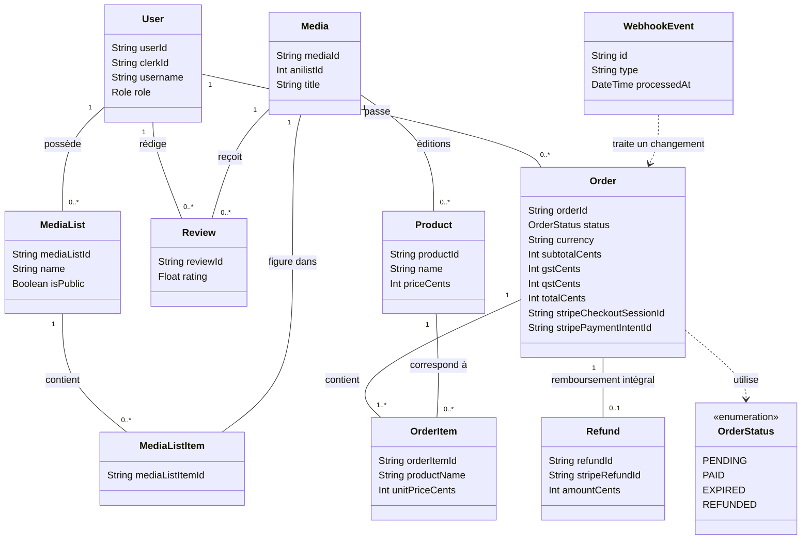
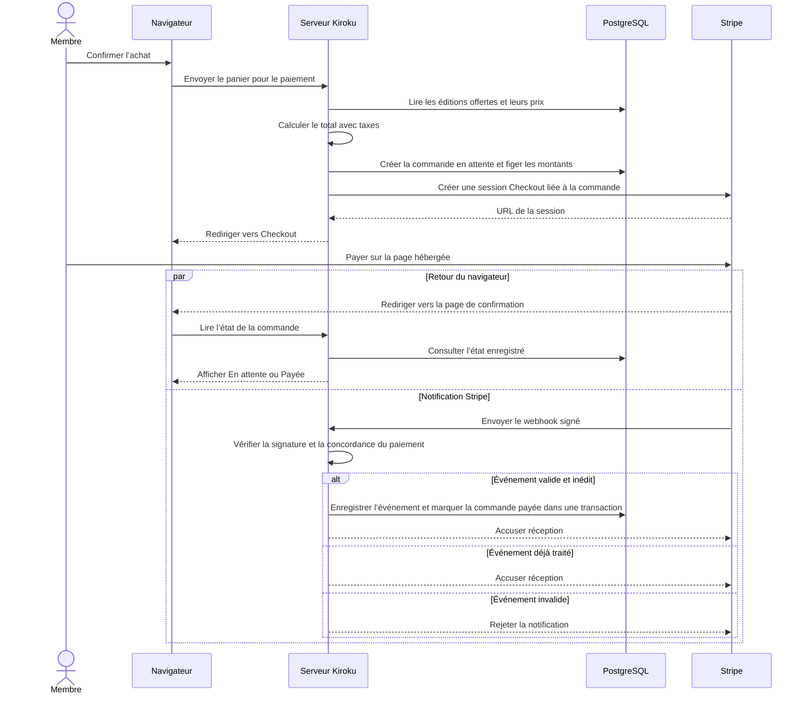
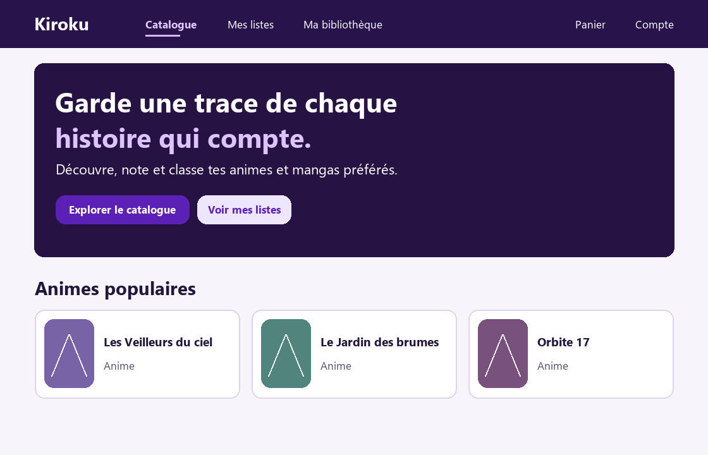
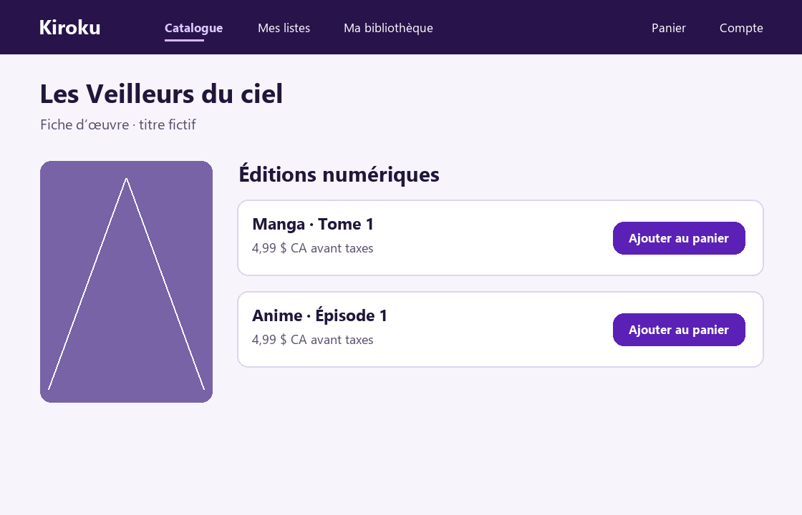
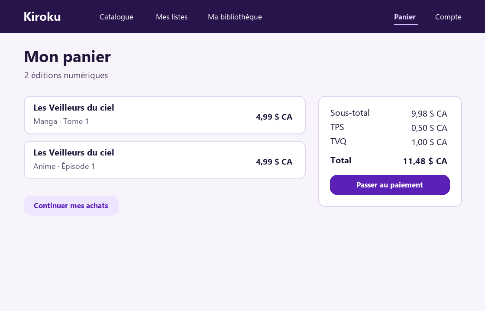
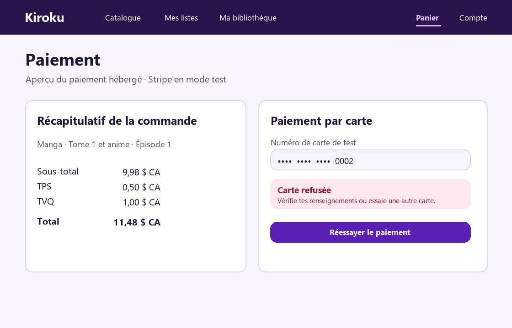
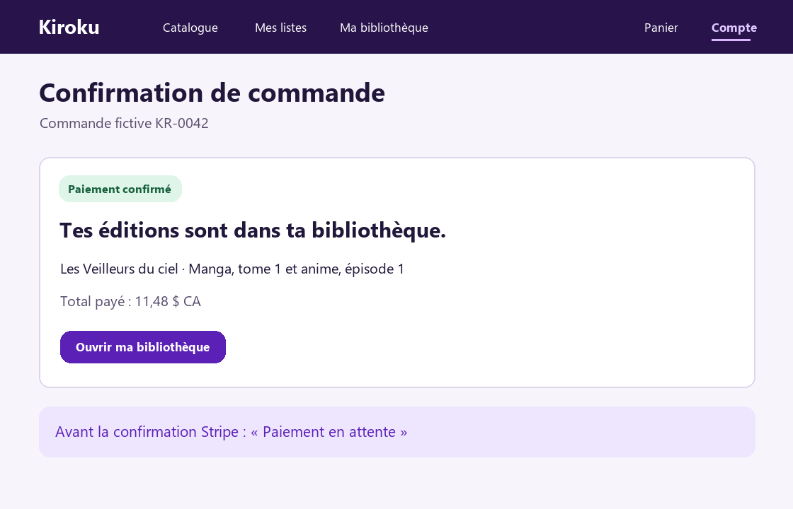
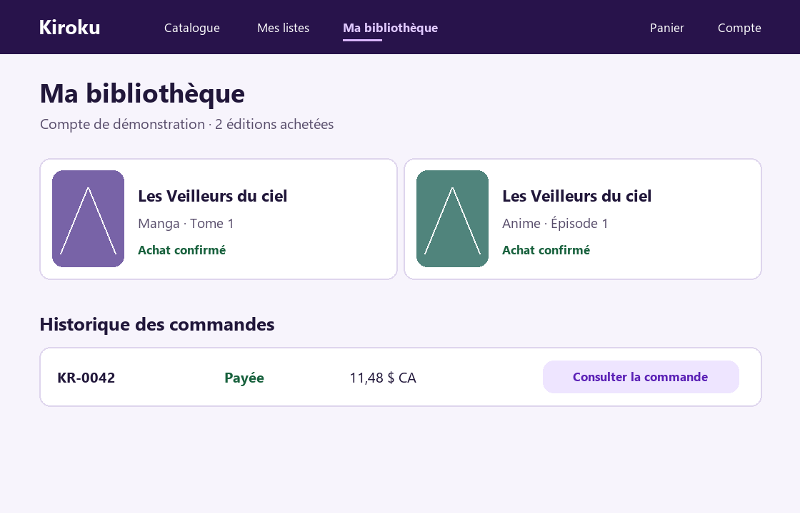

# Cahier des charges — Kiroku

- **Applications Web transactionnelles (420-951-MA), groupe 25604**
- **Laboratoire 1 · Version 0.1 · Brouillon de travail**
- **Option A - Continuité du projet de Services Web**
- **Équipe - Jean-Simon Cyr et Émile Valade**

## 1. Contexte, problème, public cible et concurrents

### 1.1 Problème et public cible

Les amateurs d’anime et de manga qui découvrent des œuvres à plusieurs endroits peuvent perdre du temps à retrouver un titre recommandé ou à reconstituer une liste à partager. Kiroku rassemble la consultation du catalogue, le classement des œuvres et leur évaluation dans une seule application Web.

La prochaine version ajoute l’achat d’éditions numériques de mangas et d’animes. Lorsqu’un membre découvre une œuvre dans le catalogue ou la retrouve dans une liste, il pourra acheter une édition numérique si elle est offerte, puis la retrouver dans sa bibliothèque Kiroku. Dans le cadre du laboratoire, le membre paie avec Stripe en mode test. La bibliothèque affiche les éditions acquises pour simuler leur livraison.

- **Public principal** - Les amateurs qui veulent découvrir des œuvres, organiser leurs listes et acheter les éditions numériques qui les intéressent.
- **Public secondaire** - Les personnes qui préparent des recommandations thématiques et souhaitent les partager.
- **Coût du problème** - La personne doit retrouver le titre, vérifier quelle édition est offerte puis chercher le bon format sur un autre service. Pour un même titre, ces recherches peuvent se répéter pour le manga et l’anime.

### Analyse de la concurrence

Prix relevés le 24 novembre 2026 sur les pages officielles. Les prix payants sont en dollars canadiens.

| Solution | Offre et points forts | Prix | Limite pour notre public |
|---|---|---|---|
| AniList | Catalogue d’animes et de mangas, listes de suivi, notes et fonctions communautaires. | Gratuit avec publicité. [Page officielle d’AniList sur Patreon](https://www.patreon.com/cw/ani_chart_list) | Pour acheter une édition, le membre doit passer par une boutique externe. |
| Rakuten Kobo | Achat de mangas numériques à l’unité, avec des tomes en français et une bibliothèque de lecture. | 8,99 $ CA pour *One Piece – Édition originale, tome 1*. [Boutique Kobo Canada](https://www.kobo.com/ca/fr/p/manga-shonen-ebooks) | L’offre de mangas concerne les livres numériques. Le lecteur doit chercher l’adaptation animée ailleurs. |
| Crunchyroll | Diffusion d’animes en continu, avec des épisodes offerts peu après leur sortie au Japon. | 109,99 $ CA par an avant taxes pour le forfait Fan, tarif de référence affiché hors promotion. [Offre canadienne de Crunchyroll](https://www.crunchyroll.com/premium?from=bottombar&return_url=https%3A%2F%2Fwww.crunchyroll.com%2Fsimulcastcalendar%3Fdate%3D2025-08-20%26filter%3Dpremium) | Le forfait Fan donne accès à un catalogue par abonnement. Il ne permet pas d’acheter une édition précise à l’unité. |

**Positionnement** — Kiroku réunit la découverte, les listes personnelles et l’achat à l’unité d’éditions numériques de mangas et d’animes dans un même compte.

## 2. Vision, SWOT, persona et 7 P

### Cercle d’or

| Cercle d’or | Kiroku |
|---|---|
| Pourquoi (Why) | Aider les amateurs à retrouver, partager et acheter les œuvres qui les intéressent. |
| Comment (How) | Relier le catalogue AniList et les listes personnelles à un panier et à une bibliothèque d’achats. |
| Quoi (What) | Une application Web de découverte et de classement avec un parcours d’achat simulé d’éditions numériques. |

La version existante permet de consulter des œuvres, de gérer des listes et de noter des titres. La version transactionnelle ajoute un panier et une bibliothèque des éditions achetées.

### SWOT

| | Facteurs favorables | Facteurs défavorables |
|---|---|---|
| Interne | Catalogue déjà intégré · Gestion des listes déjà présente · Comptes et rôles existants | Équipe de deux · Parcours de paiement à construire · Éditions de démonstration à choisir |
| Externe | Partage de recommandations entre amis · Intérêt potentiel pour une bibliothèque numérique centralisée · Communautés d’amateurs pour recueillir des retours | Concurrents établis · Disponibilité de l’API AniList · Disponibilité des éditions selon les territoires |

### Persona fictif

**Camille, 23 ans, étudiante et amatrice d’anime et de manga.** Elle garde sur son téléphone une liste des séries recommandées par ses amis. Quand une saison se termine et qu’elle veut connaître la suite, elle cherche le tome du manga qui reprend l’histoire. Elle aimerait aussi acheter certains animes pour les revoir. Devoir chercher le bon tome ou la bonne édition dans plusieurs boutiques lui fait perdre du temps. Pour un titre qu’elle a déjà envie de lire ou de revoir, Camille serait prête à payer environ 5 $ avant taxes pour l’ajouter à sa bibliothèque numérique.

### Les 7 P

| P | Proposition |
|---|---|
| Produit | Catalogue, listes, évaluations et achat simulé d’éditions numériques. |
| Prix | Fonctionnalités de base gratuites et achat unique par édition numérique. |
| Place | Application Web accessible sur ordinateur et téléphone. |
| Promotion | Présenter le parcours allant d’une fiche d’œuvre à la bibliothèque lors de la démonstration. |
| Personnes | Jean-Simon Cyr est responsable du front-end et Émile Valade du back-end. |
| Processus | Choisir une édition numérique, l’ajouter au panier et la retrouver dans sa bibliothèque après paiement. |
| Preuve physique | Prix affiché sur la fiche, récapitulatif avant paiement et confirmation de commande dans le compte. |

## 3. Modèle de paiement

Le membre paie une fois par édition numérique. Il peut acheter un tome de manga, un épisode d’anime ou les deux selon les éditions offertes. Le paiement à l’unité permet au membre de choisir les éditions qui l’intéressent et de payer uniquement pour celles de son panier. Pour la démonstration, Stripe fonctionne en mode test et la livraison est simulée par l’ajout des éditions achetées à la bibliothèque du compte. Le prix est de 4,99 $ CA avant taxes par tome de manga ou par épisode d’anime.

| Offre | Fonctionnalités | Avant taxes | TPS | TVQ | Total |
|---|---|---:|---:|---:|---:|
| Gratuit | Consulter le catalogue et les listes publiques. Avec un compte, gérer ses listes et noter des œuvres. | 0,00 $ | 0,00 $ | 0,00 $ | 0,00 $ |
| Tome de manga numérique | Ajouter un tome de manga à sa bibliothèque. | 4,99 $ | 0,25 $ | 0,50 $ | 5,74 $ |
| Épisode d’anime numérique | Ajouter un épisode d’anime à sa bibliothèque. | 4,99 $ | 0,25 $ | 0,50 $ | 5,74 $ |

**Exemple du laboratoire en cents** — Pour 499 cents, la TPS à 5 % donne 24,95 cents, arrondis à 25, et la TVQ à 9,975 % donne 49,77525 cents, arrondis à 50. Le total est de 574 cents. Chaque taxe est calculée sur le sous-total du panier et arrondie séparément (RM-04). Un panier avec un tome de manga et un épisode d’anime à 499 cents chacun totalise 1 148 cents, dont 50 cents de TPS et 100 cents de TVQ.

| Parcours | Ce que voit la personne | Réaction du système |
|---|---|---|
| Achat | Récapitulatif, paiement Stripe, puis confirmation ou attente. | Crée une commande en attente. Les éditions apparaissent dans la bibliothèque après confirmation de Stripe (RM-04 à RM-06). |
| Paiement refusé | Message d’échec sur la page de paiement et possibilité de réessayer. | Garde la commande en attente tant que la session permet un nouvel essai. Les éditions de cette commande ne sont pas ajoutées à la bibliothèque (RM-05). |
| Annulation | Retour au panier après avoir quitté Stripe. | Garde la commande en attente jusqu’à l’expiration confirmée de la session (RM-07). |
| Remboursement | Le membre demande un remboursement intégral au soutien dans les 14 jours suivant l’achat. | Après remboursement intégral confirmé, les éditions de la commande sont retirées de la bibliothèque et la commande est conservée (RM-08). |
| Renouvellement | Sans objet pour un achat unique. | Aucun prélèvement récurrent. |

Pour un paiement par carte, traiter `checkout.session.completed` si le statut du paiement est `paid`, et `checkout.session.expired` pour clore une commande encore en attente. Pour un remboursement, traiter `refund.created` et `refund.updated` en vérifiant que le statut est `succeeded` et que le montant correspond au total de la commande. [Référence des événements Stripe](https://docs.stripe.com/api/events/types)

## 4. User stories, critères d’acceptation et cas d’utilisation

### Backlog et critères d’acceptation

| ID | MoSCoW | Story |
|---|---|---|
| US-01 | Must | En tant que visiteur, je veux consulter le catalogue afin de découvrir des œuvres. |
| US-02 | Must | En tant que visiteur, je veux créer un compte afin de gérer mes listes personnelles. |
| US-03 | Must | En tant que membre, je veux créer et modifier une liste afin de classer mes recommandations. |
| US-04 | Must | En tant que membre, je veux choisir la visibilité de ma liste afin de décider si elle peut être partagée. |
| US-05 | Must | En tant que membre, je veux ajouter et retirer des œuvres afin de garder mes listes à jour. |
| US-06 | Should | En tant que membre, je veux noter une œuvre afin de conserver mon appréciation. |
| US-07 | Must | En tant que membre, je veux ajouter des éditions à mon panier et voir le total avec taxes afin de connaître le coût avant de payer. |
| US-08 | Must | En tant que membre, je veux payer sur Stripe afin d’acheter les éditions numériques de mon panier. |
| US-09 | Must | En tant que membre, je veux voir l’état de ma commande afin de savoir si mon achat est confirmé. |
| US-10 | Must | En tant que membre, je veux consulter ma bibliothèque afin de retrouver les éditions numériques que j’ai achetées. |
| US-11 | Should | En tant qu’administrateur, je veux supprimer une liste signalée afin de retirer un contenu inapproprié. |
| US-12 | Must | En tant que membre, je veux pouvoir demander un remboursement dans les 14 jours suivant mon achat afin de récupérer le montant total de ma commande. |

| ID | Story | Étant donné… | Quand… | Alors… |
|---|---|---|---|---|
| CA-01 | US-04 | une liste privée | un autre membre ouvre son URL | l’accès est refusé. |
| CA-02 | US-07 | un tome de manga et un épisode d’anime à 499 cents chacun dans le panier | le membre ouvre le récapitulatif | il voit les deux éditions, un sous-total de 998 cents, 50 cents de TPS, 100 cents de TVQ et un total de 1 148 cents. |
| CA-03 | US-08 | une commande en attente | Stripe confirme le paiement avec un événement signé et un montant concordant | la commande passe à l’état payé et les éditions achetées apparaissent dans la bibliothèque. |
| CA-04 | US-08 | une commande en attente | la carte est refusée | un message d’échec apparaît et aucune édition de cette commande n’est ajoutée à la bibliothèque. |
| CA-05 | US-09 | une commande en attente | le membre revient de Stripe avant le webhook | la page affiche une confirmation en attente. |
| CA-06 | US-09 | un événement de confirmation déjà traité | Stripe renvoie le même événement | la commande reste payée et les éditions de cette commande apparaissent une seule fois dans la bibliothèque. |
| CA-07 | US-10 | deux comptes ayant acheté des éditions différentes | un membre consulte sa bibliothèque | la bibliothèque affiche les éditions de ses propres commandes payées. |
| CA-08 | US-12 | une demande faite dans les 14 jours suivant le paiement | Stripe confirme le remboursement intégral | la commande passe à l’état remboursé et les éditions de la commande sont retirées de la bibliothèque. |

### Acteurs et cas d’utilisation

| Acteur | Rôle |
|---|---|
| Visiteur | Consulte le catalogue et les listes publiques. |
| Membre | Gère ses listes et ses notes. Peut acheter des éditions numériques et consulter sa bibliothèque. |
| Administrateur | Peut supprimer une liste d’un autre compte. |
| Clerk | Assure l’authentification. |
| AniList | Fournit les données du catalogue. |
| Stripe | Héberge la page de paiement et transmet les événements. |

#### Diagramme de cas d’utilisation


#### UC-01 — Payer

**Acteur principal** - Membre. **Acteur secondaire** - Stripe.

**Préconditions** — Le membre est connecté et son panier contient au moins une édition numérique disponible.

1. Le membre consulte le récapitulatif de son panier, avec le sous-total, les deux taxes et le total.
2. Il confirme l’achat. Le serveur enregistre la commande en attente et demande une session Stripe Checkout.
3. Le membre paie sur la page hébergée par Stripe.
4. À la réception d’un événement Stripe signé, le serveur vérifie la commande et le montant, puis enregistre le paiement. Les éditions de la commande deviennent visibles dans la bibliothèque.
5. La page de confirmation affiche l’état enregistré par le serveur.

**Variantes** - Carte refusée, retour au panier, confirmation encore en attente et notification reçue en double. Voir RM-05 à RM-07.

**Postcondition de succès** - La commande est payée et le membre retrouve les éditions achetées dans sa bibliothèque.

### Règles métier

| ID | Règle |
|---|---|
| RM-01 | Le propriétaire peut modifier sa liste. Lui et l’administrateur peuvent la supprimer. Une liste privée est accessible à son propriétaire et aux administrateurs. |
| RM-02 | Une œuvre figure au plus une fois dans une même liste. |
| RM-03 | Un membre possède au plus une évaluation par œuvre. La note est comprise entre 0 et 10. |
| RM-04 | Les montants sont des entiers en cents. La TPS et la TVQ sont calculées sur le sous-total et arrondies séparément. Le nom et le prix du produit sont figés à la commande. |
| RM-05 | Une commande devient payée après validation côté serveur du webhook Stripe signé et concordance du paiement avec la commande, le montant et la devise. |
| RM-06 | Chaque événement Stripe est traité au plus une fois. La bibliothèque affiche une seule fois chaque édition issue d’au moins une commande payée du compte. |
| RM-07 | La commande reste en attente lors d’un retour au panier. Une session expirée confirmée clôt la commande en attente. |
| RM-08 | Le membre peut demander un remboursement intégral dans les 14 jours suivant le paiement. Après confirmation de Stripe, la commande passe à l’état remboursé et ses éditions cessent d’alimenter la bibliothèque. Les commandes et remboursements sont conservés pendant la durée retenue par l’équipe. |

## 5. Diagrammes de classes et de séquence du paiement

### Diagramme de classes

Le diagramme présente le catalogue actuel et le modèle cible des achats.



### Séquence du paiement



## 6. Maquettes

Les six maquettes utilisent une œuvre fictive et illustrent le parcours d’achat en mode test. L’accueil reprend la structure de la page actuelle et montre la navigation prévue vers le panier et la bibliothèque.

### Accueil

Accès au catalogue, aux listes et à la bibliothèque.



### Tarifs

Fiche d’œuvre avec un tome de manga et un épisode d’anime à 4,99 $ CA chacun avant taxes.



### Panier

Deux éditions, sous-total de 9,98 $ CA, TPS de 0,50 $ CA, TVQ de 1,00 $ CA et total de 11,48 $ CA.



### Paiement

Aperçu du paiement hébergé en mode test, avec l’état « Carte refusée ».



### Confirmation

Numéro de commande, paiement confirmé et indication du message affiché pendant l’attente du webhook.



### Compte et bibliothèque

Éditions achetées et historique des commandes.



## 7. Schéma de base de données

### Schéma Prisma actuel

Le [fichier Prisma](../prisma/schema.prisma) définit les comptes, les œuvres, les listes et les évaluations.

```prisma
// This is your Prisma schema file,
// learn more about it in the docs: https://pris.ly/d/prisma-schema

// Get a free hosted Postgres database in seconds: `npx create-db`
generator client {
  provider = "prisma-client"
  output   = "../generated/prisma"
}

datasource db {
  provider = "postgresql"
}

// --- ENUMS ---

enum Role {
  USER
  ADMIN
}

// --- MODELES ---
model User {
  userId    String  @id @default(uuid()) @db.Uuid
  clerkId   String  @unique
  username  String  @unique
  firstName String?
  lastName  String?
  role      Role    @default(USER)

  createdAt DateTime @default(now())
  updatedAt DateTime @updatedAt

  mediaLists MediaList[]
  reviews    Review[]
}

model Media {
  mediaId   String @id @default(uuid()) @db.Uuid
  anilistId Int    @unique
  idMal     Int? // Id from MyAnimeList not necessarily present
  title     String
  avgScore  Float? // score calculated by our own app

  createdAt DateTime @default(now())
  updatedAt DateTime @updatedAt

  mediaListItems MediaListItem[]
  reviews        Review[]
}

model MediaList {
  mediaListId String   @id @default(uuid()) @db.Uuid
  userId      String   @db.Uuid
  name        String
  desc        String?
  isPublic    Boolean? @default(false)

  createdAt DateTime @default(now())
  updatedAt DateTime @updatedAt

  user User @relation(fields: [userId], references: [userId], onDelete: Cascade) // if user is deleted his list are deleted as well

  mediaListItems MediaListItem[]

  @@unique([userId, name]) // prevents duplicate list per users
}

model MediaListItem {
  mediaListItemId String @id @default(uuid()) @db.Uuid
  mediaListId     String @db.Uuid
  mediaId         String @db.Uuid

  createdAt DateTime @default(now())
  updatedAt DateTime @updatedAt

  mediaList MediaList @relation(fields: [mediaListId], references: [mediaListId], onDelete: Cascade) // if list is deleted delete its items
  media     Media     @relation(fields: [mediaId], references: [mediaId], onDelete: Cascade) // if the media is deleted delete any medialistitem that references it

  @@unique([mediaListId, mediaId]) // prevents duplicates media in lists
}

model Review {
  reviewId String  @id @default(uuid()) @db.Uuid
  userId   String  @db.Uuid
  mediaId  String  @db.Uuid
  rating   Float // in between 0 and 10
  comments String?

  createdAt DateTime @default(now())
  updatedAt DateTime @updatedAt

  user  User  @relation(fields: [userId], references: [userId], onDelete: Cascade) // if the user is deleted delete all his reviews
  media Media @relation(fields: [mediaId], references: [mediaId], onDelete: Cascade) // if the media is deleted delete all related reviews

  @@unique([userId, mediaId]) // only one review per user per media
}
```

### Modèle transactionnel prévu

Le diagramme de la section 5 prévoit cinq entités transactionnelles. `Product` associe une édition vendue à une œuvre. `Order` et `OrderItem` conservent la commande et ses éditions. `Refund` enregistre le remboursement intégral et `WebhookEvent` permet de dédupliquer les notifications Stripe. La bibliothèque affiche les éditions issues des commandes payées du membre. Ces entités seront ajoutées au schéma Prisma dans une migration transactionnelle.

- Prix et taxes en `Int`, avec le suffixe `Cents`. Nom et prix copiés dans la ligne de commande.
- Statuts sous forme d’enums, identifiants Stripe uniques et identifiant d’événement fourni par Stripe.
- Historique protégé par `onDelete: Restrict` et table de remboursements.
- Index sur les clés étrangères et filtres fréquents, au moins une contrainte `CHECK` dans une migration et validation du schéma demandée par le laboratoire.

## 8. Exigences non fonctionnelles

| ID | Exigence et mesure |
|---|---|
| ENF-01 | La saisie des données de carte se fait sur Stripe Checkout. Vérifier qu’aucune donnée de carte ne figure dans la base ni dans les journaux Kiroku. |
| ENF-02 | Les secrets sont stockés dans les variables d’environnement. Une notification à signature invalide doit être rejetée sans modifier la commande. |
| ENF-03 | Objectif de validation. Sur la version de démonstration, ouvrir le catalogue dix fois avec le cache du navigateur désactivé. Mesurer du début de la navigation à l’apparition des premières fiches. Cible de moins de 2 secondes pour au moins 9 essais sur 10. Consigner l’appareil, le réseau et les résultats. |
| ENF-04 | Le compte Kiroku conserve l’identifiant Clerk, le nom d’utilisateur, le rôle et, s’ils sont fournis, le prénom et le nom. Le modèle cible ajoute les éditions achetées, les montants, les statuts de commande et les identifiants Stripe. Vérifier ces données dans le schéma avant la remise. [À compléter] Confirmer le consentement applicable, les durées de conservation, le responsable et les régions d’hébergement. Si les données sont hébergées hors Québec, prévoir l’évaluation demandée par le laboratoire avant la mise en production. |

## 9. Planification et rôles

| Jalon | Travail prévu pour Kiroku |
|---|---|
| Laboratoire 1 · Cahier des charges | Analyser le besoin, définir le prix et le parcours d’achat, puis finaliser les stories, les diagrammes UML et les maquettes. Préparer le schéma des commandes, les consignes de l’agent et le journal IA. |
| Laboratoire 2 · Back-end et panier | Permettre d’ajouter un tome de manga ou un épisode d’anime au panier et calculer le total avec taxes côté serveur (US-07). |
| Laboratoire 3 · Intégration Stripe | Intégrer Stripe Checkout en mode test et afficher l’état de la commande après confirmation du paiement (US-08, US-09). |
| Présentation · Vers la mi-décembre 2026 (date exacte à confirmer) | Démontrer un paiement accepté, un refus et l’affichage des éditions achetées dans la bibliothèque (US-08 à US-10). |

**Répartition de l’équipe** — Jean-Simon Cyr est responsable du front-end. Émile Valade est responsable du back-end. Chaque membre contribue avec son compte Git.

## 10. Technologie choisie

| Couche | Choix | Justification |
|---|---|---|
| Interface et serveur | Next.js et TypeScript | Reprendre l’application et ses actions serveur dans le même dépôt. |
| Données | PostgreSQL sur Neon, avec Prisma | Conserver le modèle relationnel existant et ajouter les commandes et leurs relations. |
| Authentification | Clerk | Réutiliser l’inscription et la connexion existantes. |
| Catalogue | AniList GraphQL via Axios | Réutiliser les fiches des œuvres. Les éditions offertes et leurs prix sont gérés dans Kiroku. |
| Paiement de démonstration | Stripe Checkout en mode test et webhooks | Faire saisir les données de carte sur une page hébergée et confirmer les paiements côté serveur. |

## 11. Journal d’utilisation de l’IA et configuration de l’agent

- Le [journal IA](journal-ia.md) consigne trois usages réels.
- Les [consignes de l’agent](../CLAUDE.md) décrivent le projet, les commandes et les règles métier. La [configuration Claude](../.claude/settings.json) interdit la lecture de `.env`.

## 12. Rédaction et traçabilité

Le panier est vérifié par CA-02 (US-07, RM-04). Les critères CA-03 à CA-06 couvrent le paiement et la confirmation (US-08 et US-09, RM-05 et RM-06). Les critères CA-07 et CA-08 couvrent la bibliothèque et le remboursement (US-10 et US-12, RM-06 et RM-08).

La confidentialité des listes est couverte par CA-01 (US-04, RM-01). Chaque membre contribue avec des commits au format `type: description`.
