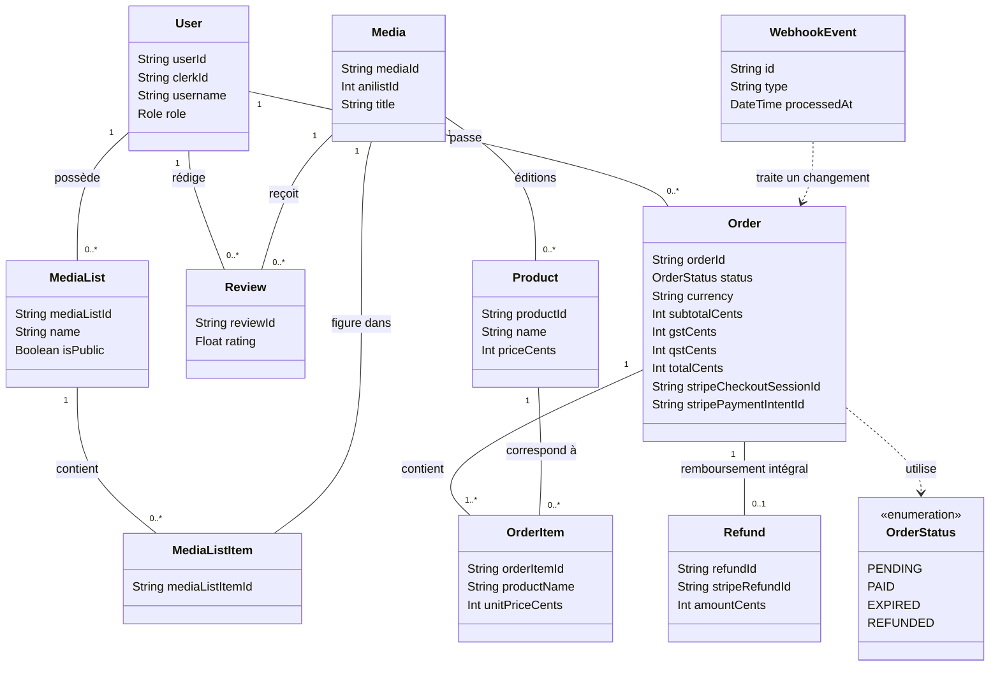

# Diagramme de classes — Kiroku

Les classes de catalogue, de listes et de notes proviennent du schéma actuel. Les classes de commande décrivent le modèle cible du laboratoire. La bibliothèque est calculée à partir des lignes des commandes payées du membre.

