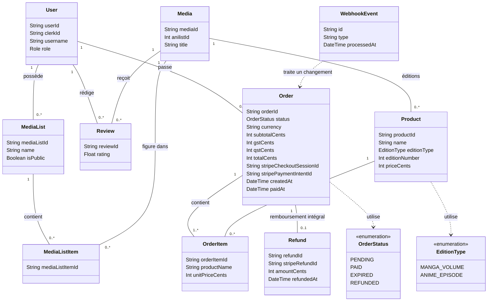

# Diagramme de classes — Kiroku

Le diagramme présente le catalogue, les listes, les notes et les commandes du schéma Prisma. La bibliothèque est calculée à partir des lignes des commandes payées du membre.

